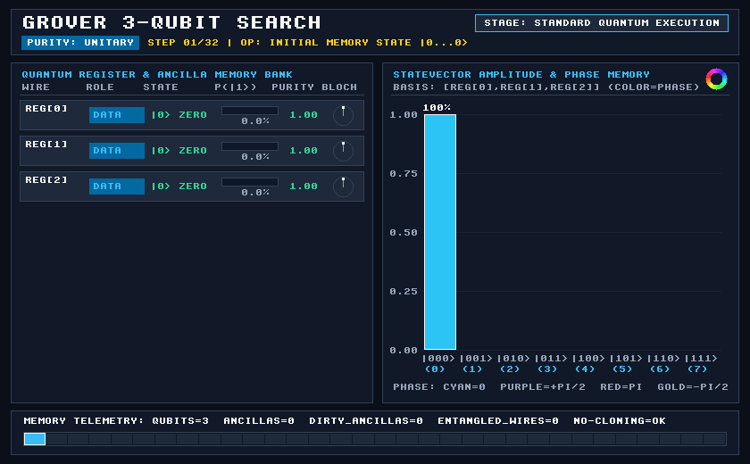
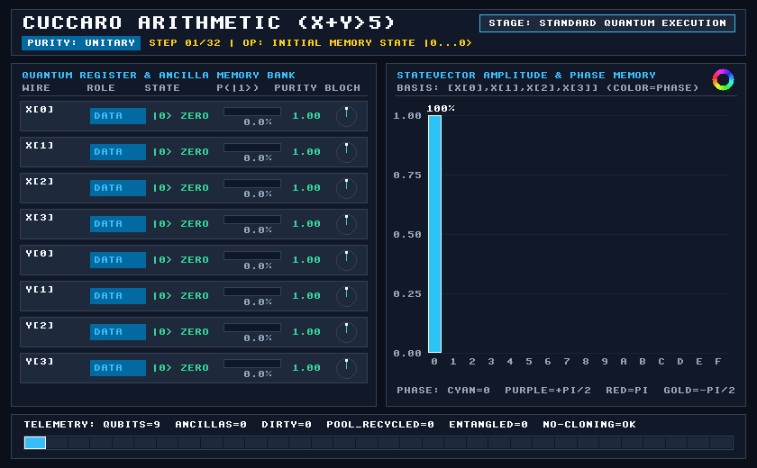
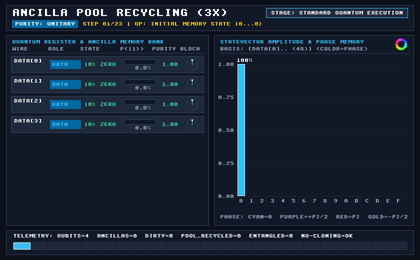

# QGo (`.qg`) — High-Level Statically-Typed Quantum Programming Language

QGo is a Go-inspired, statically-typed, self-hosting quantum programming language implemented in Rust. It enforces quantum physics invariants at compile time (No-Cloning disjoint aliasing, No-Leaked-Ancilla, Linear Type Ownership, `qfree` / `unitary` / `hybrid` purity hierarchy, and automatic `defer adj` ancilla uncomputation) and compiles ahead-of-time to **OpenQASM 3.0**, **QIR (LLVM IR)**, **HUGR**, and **Native Executables** (`--target=rs` / `--target=native`).

---

## Documentation Suite (`docs/`)

- [**Documentation Hub (`docs/INDEX.md`)**](./docs/INDEX.md) — Overview, CLI quickstart, and animated quantum memory gallery.
- [**Formal Language Specification (`docs/LANGUAGE_SPEC.md`)**](./docs/LANGUAGE_SPEC.md) — Lexical rules, Go ASI, linear quantum types, purity tiers, `defer adj`, `ctrl`/`adj`, quantum conditionals, built-ins, and EBNF grammar.
- [**Quantum Memory Model (`docs/QUANTUM_MEMORY_MODEL.md`)**](./docs/QUANTUM_MEMORY_MODEL.md) — Linear quantum wire lifecycle, Physical Qubit Pool / Ancilla Recycling Allocator, Classical Tri-Color Mark-and-Sweep GC, reduced density matrix purity $\text{Tr}(\rho_q^2)$, Bloch vector telemetry, Pass 3.2 `ctrl`-conjugation optimization, and annotated memory GIF walkthroughs.
- [**Standard Quantum Algorithms Guide (`docs/ALGORITHMS_GUIDE.md`)**](./docs/ALGORITHMS_GUIDE.md) — Mathematical & code walkthrough of all 13 verified quantum algorithms & memory benchmarks in `std/` with embedded animated memory GIFs.
- [**Compiler & Runtime Architecture (`docs/COMPILER_ARCHITECTURE.md`)**](./docs/COMPILER_ARCHITECTURE.md) — Deep dive into the 11 Rust crates, HIR/MIR/Opt passes, codegen backends, simulators, and 3-stage self-hosting bootstrap compiler.

---

## Animated Quantum Memory Preview (`qgo viz`)







---

## Workspace Architecture

- `crates/qgo_span` — Source spans, file IDs, string interning, and Ariadne-style rich terminal diagnostics.
- `crates/qgo_lexer` — Tokenizer with Go Automatic Semicolon Insertion (ASI).
- `crates/qgo_syntax` — Lossless CST/AST nodes, recursive-descent + Pratt expression parser, and `qgo fmt` canonical source formatter.
- `crates/qgo_hir` — Name resolution, type inference, purity hierarchy checker (`qfree` < `unitary` < `hybrid`), Disjoint Aliasing, No-Leaked-Ancilla, Linear Move, and static index bounds checking.
- `crates/qgo_mir` — Mid-Level Quantum IR (`MirStmt::Conjugate`, structural `adj` inversion, Pass 3.2 `ctrl`-conjugation theorem $\text{ctrl}_c(U V U^\dagger) = U (\text{ctrl}_c V) U^\dagger$, and compile-time loop unrolling).
- `crates/qgo_opt` — Reversible arithmetic synthesis (`--synth-mode=width` Cuccaro ripple-carry adder & `--synth-mode=depth` Draper QFT adder), quantum conditional lowering, rotation merging, commutation-aware gate cancellation, **Pass 4.5 Physical Ancilla Pool Recycling (`recycle_ancillas`)**, and resource estimation.
- `crates/qgo_codegen_qasm` — OpenQASM 3.0 backend.
- `crates/qgo_codegen_qir` — QIR (LLVM IR Base/Adaptive Profile), HUGR JSON, and AOT Rust/Native codegen (`emit_rust_aot`).
- `crates/qgo_sim` — Built-in `StatevectorSim` ($2^N$ complex statevector with physical qubit pool recycling), `StabilizerSim` ($O(N^2)$ Aaronson-Gottesman CHP stabilizer tableau), `ClassicalHeapGC` (Tri-Color Mark-and-Sweep classical tracing garbage collector), `QGoVM` (hybrid classical-quantum virtual machine), and `qgo_sim::viz` (animated GIF89a quantum memory tracer).
- `crates/qgo_lsp` — Language Server Protocol diagnostic publisher.
- `crates/qgo_driver` — End-to-end compiler driver and `qgo` CLI (`build`, `run`, `test`, `estimate`, `viz`, `fmt`, `lsp`).
- `std/` — Verified standard library of 13 quantum algorithms & memory benchmarks (`qft.qg`, `arith.qg`, `grover.qg`, `deutsch_jozsa.qg`, `bernstein_vazirani.qg`, `simon.qg`, `phase_est.qg`, `shor.qg`, `teleport.qg`, `qec.qg`, `vqe_qaoa.qg`, `quantum_walk.qg`, `memory_gc.qg`).
- `selfhost/qgo_compiler.qg` — Self-hosting QGo compiler written in QGo itself, verified via a 3-stage bootstrap fixed point (`Stage 0 -> Stage 1 -> Stage 2 == Stage 3`).

---

## Quick Start

```bash
# Run the full workspace test suite (all crates, all 12 std algorithms, 10 animated GIFs, and 3-stage self-hosting bootstrap)
cargo test --workspace

# Compile Grover's search algorithm to OpenQASM 3.0
cargo run -p qgo_driver -- build std/grover.qg --target=qasm

# Compile to QIR (LLVM IR Adaptive Profile)
cargo run -p qgo_driver -- build std/grover.qg --target=qir

# Estimate quantum resources (logical qubits, ancillas, Toffoli count, T-count, depth)
cargo run -p qgo_driver -- estimate std/grover.qg --synth-mode=width

# Simulate and run all unit tests on StatevectorSim, StabilizerSim, and QGoVM
cargo run -p qgo_driver -- test std/shor.qg

# Generate an animated GIF illustrating quantum memory evolution
cargo run -p qgo_driver -- viz std/grover.qg GroverSearch3Qubit -o docs/gifs/grover_memory.gif

# Compile the self-hosting QGo compiler (`selfhost/qgo_compiler.qg`) into a native executable
cargo run -p qgo_driver -- build selfhost/qgo_compiler.qg --target=native -o /tmp/qgo_selfhost
/tmp/qgo_selfhost test
```
