# QGo Standard Quantum Algorithms Guide (`std/`)

QGo ships with a verified standard library of **13 canonical quantum algorithms & memory benchmarks** in [`std/`](../std/). Every algorithm compiles to **OpenQASM 3.0**, **LLVM QIR 1.0**, and **Quantinuum HUGR v1 JSON**, passes exact statevector and Clifford stabilizer verification (`P(|0>) = 1.0` on all ancillas within $10^{-12}$), and includes executable `Test*` assertions verified by `QGoVM`.

---

## Summary Table & Resource Estimates

| # | Algorithm | Source File | Key QGo Features Demonstrated | Verified Test Entrypoint |
| :-: | :--- | :--- | :--- | :--- |
| 1 | **Quantum Fourier Transform (QFT)** | [`std/qft.qg`](../std/qft.qg) | `unitary`, `CP(theta)`, `Swap`, `adj QFT4` round-trip | `TestQFTRoundTrip` |
| 2 | **Cuccaro & Draper Reversible Arithmetic** | [`std/arith.qg`](../std/arith.qg) | `qfree` `MAJ`/`UMA`, `qint[4]`, quantum `if x + y > 5` | `TestReversibleArithmetic` |
| 3 | **Grover's Unstructured Search** | [`std/grover.qg`](../std/grover.qg) | `defer adj` phase kickback, `ctrl(...)`, slice broadcast `H(reg[:])` | `TestGroverSearch` |
| 4 | **Deutsch-Jozsa Algorithm** | [`std/deutsch_jozsa.qg`](../std/deutsch_jozsa.qg) | Constant vs. balanced `qfree` oracles, `defer adj` | `TestDeutschJozsa` |
| 5 | **Bernstein-Vazirani Secret Recovery** | [`std/bernstein_vazirani.qg`](../std/bernstein_vazirani.qg) | Hidden linear string $s = 1101_2$ extraction in 1 query | `TestBernsteinVazirani` |
| 6 | **Simon's Periodicity Algorithm** | [`std/simon.qg`](../std/simon.qg) | 2-to-1 periodic oracle $f(x) = f(x \oplus s)$, orthogonal subspace | `TestSimonPeriod` |
| 7 | **Quantum Phase Estimation (QPE)** | [`std/phase_est.qg`](../std/phase_est.qg) | Dyadic `ctrl` $T^{2^k}$ powers, inverse `adj QFT3` | `TestQuantumPhaseEstimation` |
| 8 | **Shor's Factoring ($N = 15$)** | [`std/shor.qg`](../std/shor.qg) | Modular exponentiation $7^x \bmod 15$, QPE, classical `GCD` | `TestShorFactor15` |
| 9 | **Quantum Teleportation & Superdense Coding** | [`std/teleport.qg`](../std/teleport.qg) | Hybrid mid-circuit `measure`, classical feed-forward `if` | `TestTeleportAndSuperdense` |
| 10 | **3-Qubit Bit-Flip Quantum Error Correction** | [`std/qec.qg`](../std/qec.qg) | Syndrome extraction, Toffoli recovery, `defer adj` syndrome check | `TestQuantumErrorCorrection` |
| 11 | **QAOA MaxCut ($K_3$) & VQE Ansatz** | [`std/vqe_qaoa.qg`](../std/vqe_qaoa.qg) | Ising $ZZ$ parity gadgets with `defer adj`, `Rx`/`Ry`/`Rz` layers | `TestQAOAAndVQE` |
| 12 | **Coined Discrete-Time Quantum Walk** | [`std/quantum_walk.qg`](../std/quantum_walk.qg) | Controlled modular increment/decrement, `defer adj` carry ancilla | `TestQuantumWalk` |
| 13 | **Physical Qubit Pool & Classical Mark-and-Sweep GC** | [`std/memory_gc.qg`](../std/memory_gc.qg) | 3-stage ancilla pool recycling (`qpool_recycled_count`), Tri-Color GC (`gc_collect`) | `TestQuantumPoolAndClassicalGC` |

---

## 1. Quantum Fourier Transform ([`std/qft.qg`](../std/qft.qg))

The $N$-qubit Quantum Fourier Transform maps a computational basis state $\vert x \rangle$ into the Fourier phase basis:

$$\text{QFT}_N \vert x \rangle = \frac{1}{\sqrt{2^N}} \sum_{k=0}^{2^N-1} e^{2\pi i x k / 2^N} \vert k \rangle = \bigotimes_{j=0}^{N-1} \frac{\vert 0\rangle + e^{2\pi i \cdot 0.x_{N-1-j}\dots x_0}\vert 1\rangle}{\sqrt{2}}$$

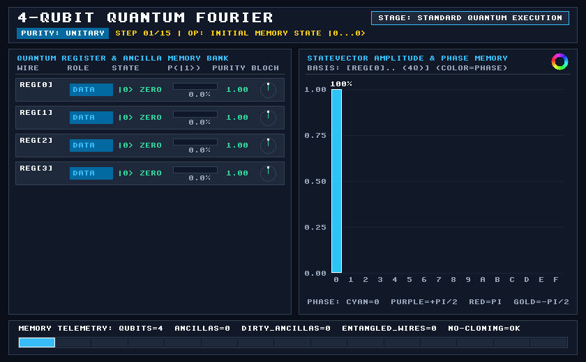

```go
func QFT4(reg qreg[4]) unitary {
    H(reg[0])
    CP(1.5707963267948966, reg[1], reg[0])
    CP(0.7853981633974483, reg[2], reg[0])
    CP(0.39269908169872414, reg[3], reg[0])
    H(reg[1])
    CP(1.5707963267948966, reg[2], reg[1])
    CP(0.7853981633974483, reg[3], reg[1])
    H(reg[2])
    CP(1.5707963267948966, reg[3], reg[2])
    H(reg[3])
    Swap(reg[0], reg[3])
    Swap(reg[1], reg[2])
}
```
- **Memory Insight**: Because $\text{QFT}_4 \vert 0101\rangle$ is a tensor product of 4 rotated single-qubit states on the XY equator of the Bloch sphere, every wire maintains unit purity $\text{Tr}(\rho_q^2) = 1.00$ (`SUPERPOS`) while the 16 statevector amplitudes display the periodic phase rainbow $\phi_k = 2\pi \cdot 5k / 16$.

---

## 2. Cuccaro Ripple-Carry Arithmetic & Quantum Conditionals ([`std/arith.qg`](../std/arith.qg))

Implements Cuccaro et al.'s linear-depth ripple-carry adder using the 3-gate `MAJ` (Majority-In-Place) and `UMA` (UnMajority-and-Add) building blocks, as well as QGo's built-in `qint[4]` arithmetic and coherent quantum conditionals:

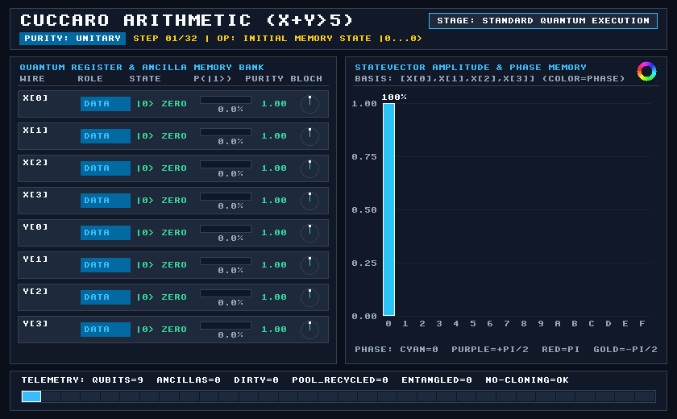

```go
func MAJ(c qubit, b qubit, a qubit) qfree {
    CX(a, b)
    CX(a, c)
    CCX(c, b, a)
}

func UMA(c qubit, b qubit, a qubit) qfree {
    CCX(c, b, a)
    CX(a, c)
    CX(c, b)
}

func ConditionalFlipIfSumGt5(x qint[4], y qint[4], target qubit) unitary {
    X(x[0]); X(x[1]) // x = 3
    X(y[2])          // y = 4
    if x + y > 5 {
        X(target)
    }
}
```

---

## 3. Grover's Amplitude Amplification ([`std/grover.qg`](../std/grover.qg))

Applies $k_{\text{opt}} = \lfloor \frac{\pi}{4}\sqrt{8} \rfloor = 2$ iterations of the Grover operator $G = (2\vert \psi_0\rangle\langle\psi_0\vert - I) O_f$ on $N = 3$ qubits, amplifying the marked state $\vert 111\rangle = \vert 7\rangle$ from $1/8 = 12.5\%$ to $7/8 \approx 94.53\%$ (iteration 1) and $121/128 \approx 94.53\%$ (iteration 2):

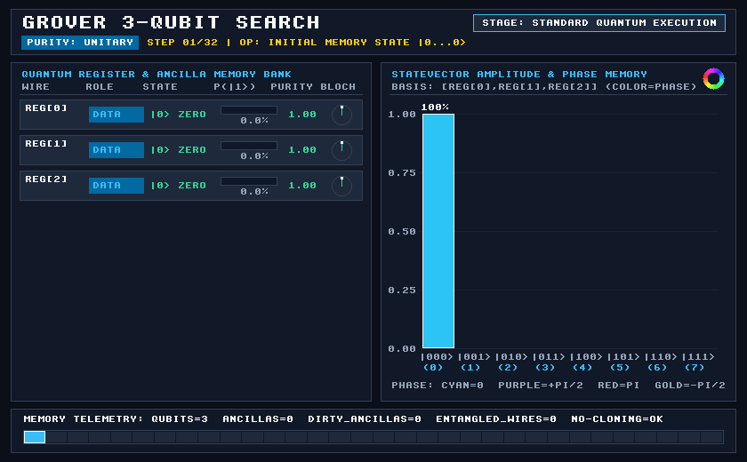

---

## 4. Deutsch-Jozsa Oracle Classification ([`std/deutsch_jozsa.qg`](../std/deutsch_jozsa.qg))

Determines in a **single** quantum evaluation whether $f: \{0,1\}^4 \to \{0,1\}$ is constant or balanced. For the balanced parity oracle $f(x) = x_0 \oplus x_1 \oplus x_2 \oplus x_3$, interference after the final `H(x[:])` layer drives $P(\vert 0000\rangle) = 0$ and concentrates $100\%$ of the probability at $\vert 1111\rangle = \vert 15\rangle$:

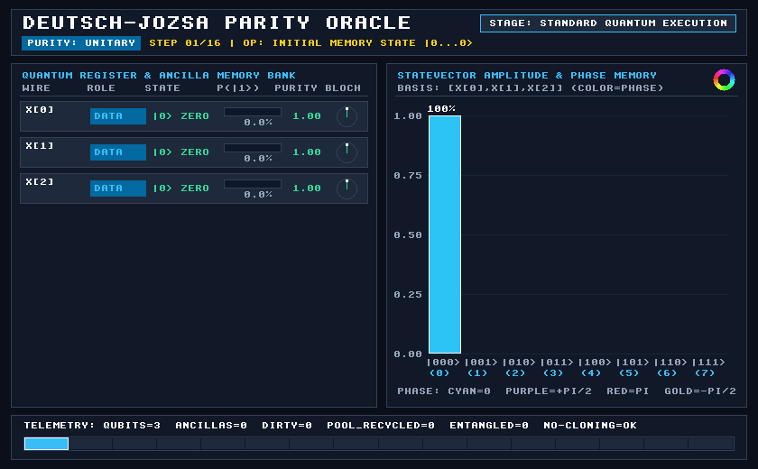

```go
func DeutschJozsaBalanced(x qreg[4]) unitary {
    H(x[:])
    anc := qalloc()
    BalancedParityOracle(x, anc)
    defer adj BalancedParityOracle(x, anc) -> anc
    Z(anc)
    H(x[:])
}
```

---

## 5. Bernstein-Vazirani Secret String Extraction ([`std/bernstein_vazirani.qg`](../std/bernstein_vazirani.qg))

Recovers the hidden 4-bit string $s = 13 = 1101_2$ from the inner-product oracle $f_s(x) = s \cdot x \bmod 2$ in a single oracle conjugation query:

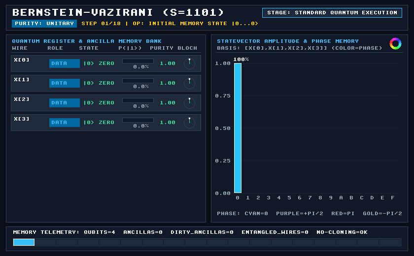

---

## 6. Simon's Periodicity Algorithm ([`std/simon.qg`](../std/simon.qg))

Constructs a 2-to-1 function $f: \{0,1\}^2 \to \{0,1\}^2$ with hidden period $s = 11_2 = 3$ ($f(x) = f(x \oplus 3)$). Measuring the first register after `H(x[:])` yields only bitstrings $z \in \{00_2, 11_2\}$ satisfying $z \cdot s \equiv 0 \pmod 2$ with $50\%$ probability each (`P(|0>) = 0.5, P(|3>) = 0.5`).

---

## 7. Quantum Phase Estimation ([`std/phase_est.qg`](../std/phase_est.qg))

Estimates the eigenphase $\theta = 1/8$ of the $T$-gate ($T\vert 1\rangle = e^{2\pi i / 8}\vert 1\rangle$) using a 3-qubit counting register `phase[0..3]`, controlled dyadic powers $T^{2^0}, T^{2^1}, T^{2^2}$, and the structural inverse `adj QFT3(phase)`, collapsing deterministically onto $\vert \text{phase}\rangle = \vert 8\theta \rangle = \vert 001_2 \rangle = \vert 1\rangle$ with probability $100\%$:

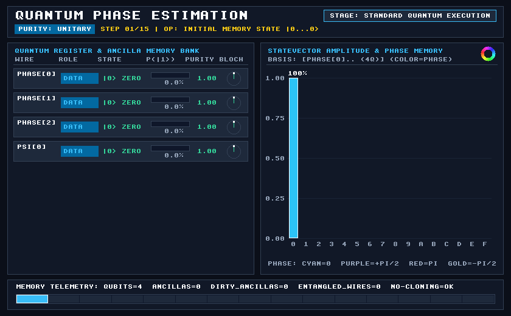

---

## 8. Shor's Factoring Algorithm for $N = 15$ ([`std/shor.qg`](../std/shor.qg))

Implements coherent modular exponentiation $U_a \vert x \rangle \vert y \rangle = \vert x \rangle \vert (y \cdot a^x) \bmod 15 \rangle$ for base $a = 7$ using controlled Fredkin (`CSwap`) permutation networks for $\times 7 \bmod 15$ and $\times 4 \bmod 15$, followed by inverse QFT (`adj QFT3(exp)`) and classical Euclidean `GCD(7^(r/2) ± 1, 15)` post-processing to extract the prime factors $p = 3$ and $q = 5$:

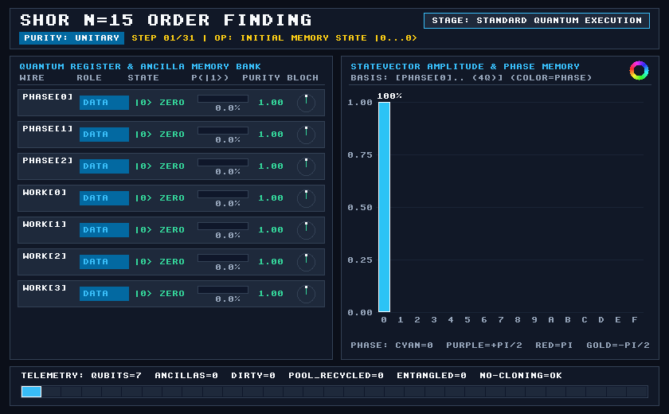

- Observe in the memory dashboard how the 3 exponent qubits `exp[0..3]` and 4 work-register qubits `work[0..4]` become entangled ($\text{Tr}(\rho_q^2) = 0.50$) during modular exponentiation, producing the four period-4 harmonic peaks at $k \in \{0, 2, 4, 6\}$ (`25%` each, encoding period $r = 8 / 2 = 4$).

---

## 9. Quantum Teleportation & Superdense Coding ([`std/teleport.qg`](../std/teleport.qg))

Demonstrates QGo's hybrid classical-quantum execution tier (`measure(q)` + mid-circuit classical `if` feed-forward):
- **`TeleportBit(payload_bit int) -> int`**: Prepares an entangled Bell pair $\frac{\vert 00\rangle + \vert 11\rangle}{\sqrt{2}}$, performs a Bell measurement on Alice's payload and half-pair, and applies conditional Pauli `X(bob)` / `Z(bob)` corrections to recover Alice's state on Bob's qubit.
- **`SuperdenseTransmit(b1 int, b0 int) -> int`**: Transmits 2 classical bits over 1 shared Bell qubit via Pauli encoding ($I, X, Z, XZ$) and `BellDecode`.

---

## 10. 3-Qubit Bit-Flip Quantum Error Correction ([`std/qec.qg`](../std/qec.qg))

Encodes a single logical qubit into the 3-qubit repetition code $\alpha\vert 000\rangle + \beta\vert 111\rangle$, injects single-qubit Pauli-$X$ bit-flip errors on any wire $q \in \{0, 1, 2\}$, extracts the 2-bit parity syndrome $s_0 = c_0 \oplus c_1, s_1 = c_1 \oplus c_2$ without measuring the logical data, and corrects the corrupted wire via Toffoli decoding:

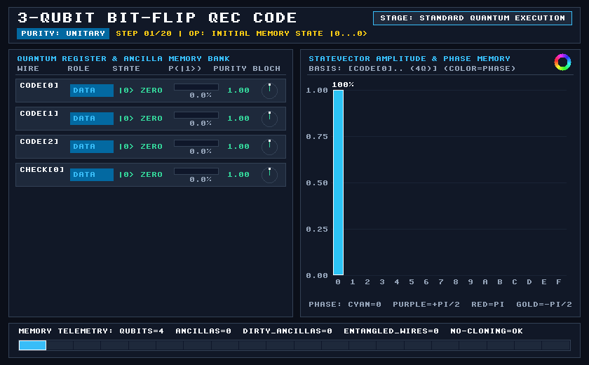

---

## 11. QAOA MaxCut on $K_3$ & VQE Hardware-Efficient Ansatz ([`std/vqe_qaoa.qg`](../std/vqe_qaoa.qg))

Implements a $p = 1$ Quantum Approximate Optimization Algorithm (QAOA) circuit for MaxCut on the 3-regular triangle graph $K_3$. Each edge cost unitary $e^{-i\gamma Z_u Z_v}$ is synthesized using a `qfree` parity ancilla gadget (`IsingZZParity`) with `defer adj` uncomputation:

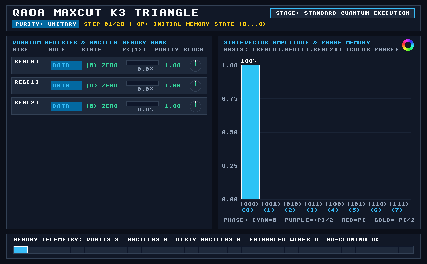

- Starting from the uniform superposition where the 6 valid MaxCut partitions ($\vert 001\rangle, \vert 010\rangle, \vert 011\rangle, \vert 100\rangle, \vert 101\rangle, \vert 110\rangle$) have probability $6/8 = 75.0\%$, a single QAOA layer amplifies the MaxCut probability to **$86.77\%$** ($14.5\%$ per cut state, suppressing the uncut states $\vert 000\rangle, \vert 111\rangle$ to $6.6\%$ each).

---

## 12. Coined Discrete-Time Quantum Walk on an 8-Cycle ([`std/quantum_walk.qg`](../std/quantum_walk.qg))

Simulates a discrete-time coined quantum walk on the 8-node cycle graph $C_8$ (`pos qreg[3]`, `coin qubit`). Each step applies a Hadamard coin toss `H(coin)`, increments `pos` modulo 8 when `coin == 1`, and decrements `pos` modulo 8 (`adj IncrementCycle8(pos)`) when `coin == 0`:

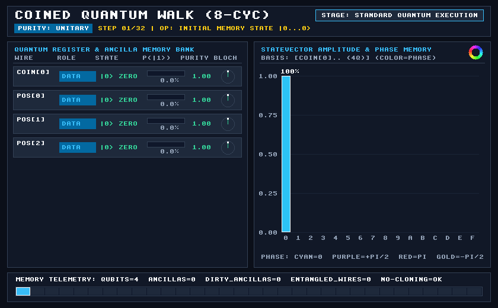

- Starting at node $\vert 4\rangle = \vert 100_2\rangle$, after 3 steps of coherent ballistic interference the walker resides exclusively on odd-parity nodes $\{1, 3, 5, 7\}$ with total probability $1.0$, while the carry ancilla `carry[0]` is allocated, entangled, and uncomputed to $\vert 0\rangle$ six times across the circuit.

---

## 13. Physical Qubit Pool & Classical Mark-and-Sweep GC ([`std/memory_gc.qg`](../std/memory_gc.qg))

Demonstrates both QGo's **Physical Qubit Pool / Ancilla Recycling Allocator** (`MultiStageAncillaPipeline`) and the **Classical Runtime Tri-Color Mark-and-Sweep Garbage Collector** (`TestQuantumPoolAndClassicalGC`):

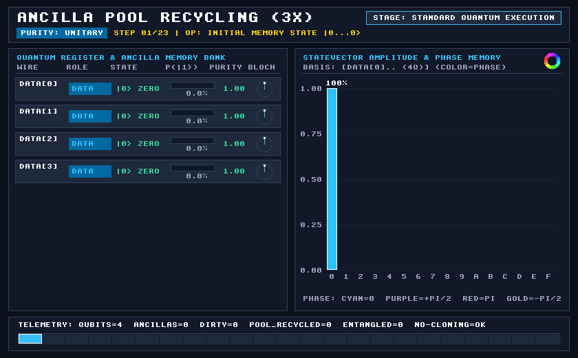

- **Quantum Ancilla Pool Recycling**: Across 3 sequential oracle stages (`ParityOracle01`, `AndOracle12`, `ParityOracle23`), `anc2` and `anc3` reuse the physical wire freed by `defer adj ... -> anc1` (`qpool_peak_qubits() == 5`, `qpool_recycled_count() == 2`), reducing the statevector dimension by $4\times$ ($2^5 = 32$ vs. $2^7 = 128$).
- **Classical Tri-Color Tracing GC**: Allocates ephemeral `HeapPacket` structs and slices inside `AllocateEphemeralBatch`, retains a reachable root `root_pkt` in the outer stack frame, and invokes `gc_collect()` to verify that unreachable objects are swept while `root_pkt` survives intact.

