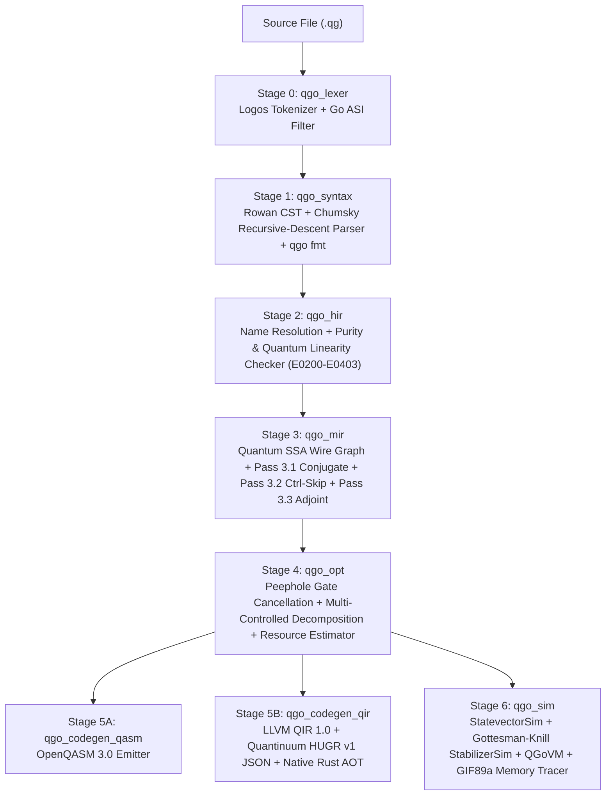

# QGo Compiler & Runtime Architecture

The QGo compiler is architected as a modular 11-crate Rust workspace ([`Cargo.toml`](../Cargo.toml)) paired with a self-hosting compiler written in QGo itself ([`selfhost/qgo_compiler.qg`](../selfhost/qgo_compiler.qg)).

---

## 1. End-to-End Compilation Pipeline



---

## 2. Workspace Crate Breakdown

| Crate | Path | Responsibility |
| :--- | :--- | :--- |
| **`qgo_span`** | [`crates/qgo_span`](../crates/qgo_span/src/lib.rs) | Byte spans (`Span`), multi-file `SourceMap`, `lasso` symbol interning, and `ariadne`-style diagnostic rendering. |
| **`qgo_lexer`** | [`crates/qgo_lexer`](../crates/qgo_lexer/src/lib.rs) | Zero-copy `logos` scanner and Go-compliant Automatic Semicolon Insertion (ASI) token filter. |
| **`qgo_syntax`** | [`crates/qgo_syntax`](../crates/qgo_syntax/src/lib.rs) | Lossless `rowan` Concrete Syntax Tree (CST), typed AST nodes, error-recovering `chumsky` parser, and canonical `qgo fmt` source formatter. |
| **`qgo_hir`** | [`crates/qgo_hir`](../crates/qgo_hir/src/lib.rs) | Symbol resolution, constant folding, classical/quantum type checking, purity lattice enforcement (`qfree` $\subset$ `unitary` $\subset$ Hybrid), and linear ownership checker (`E0400`–`E0403`). |
| **`qgo_mir`** | [`crates/qgo_mir`](../crates/qgo_mir/src/lib.rs) | Quantum SSA wire-graph lowering (`MirStmt`), Pass 3.1 `Conjugate` synthesis, Pass 3.2 Control-Skip optimization, Pass 3.3 structural `adj` inversion, and Cuccaro/Draper arithmetic synthesis. |
| **`qgo_opt`** | [`crates/qgo_opt`](../crates/qgo_opt/src/lib.rs) | Peephole gate cancellation ($X^2=I, H^2=I, CX^2=I, R_z(\theta_1)R_z(\theta_2)=R_z(\theta_1+\theta_2)$), multi-controlled Barenco Toffoli decomposition (`SynthMode::Width` vs. `SynthMode::Depth`), and static fault-tolerant resource estimation (`T`-count, Toffoli count, circuit depth). |
| **`qgo_codegen_qasm`** | [`crates/qgo_codegen_qasm`](../crates/qgo_codegen_qasm/src/lib.rs) | Standards-compliant **OpenQASM 3.0** emitter with `qubit[N]`, `bit[N]`, `ctrl @`, `inv @`, and structured compute/uncompute comments. |
| **`qgo_codegen_qir`** | [`crates/qgo_codegen_qir`](../crates/qgo_codegen_qir/src/lib.rs) | Emits **QIR 1.0 Base/Adaptive LLVM IR** (`%Qubit*`, `@__quantum__qis__*`), **Quantinuum HUGR v1 JSON**, and standalone **Native Rust AOT** source ([`rust_backend.rs`](../crates/qgo_codegen_qir/src/rust_backend.rs)). |
| **`qgo_sim`** | [`crates/qgo_sim`](../crates/qgo_sim/src/lib.rs) | Exact $2^N$ complex `StatevectorSim`, polynomial-time $O(N^2)$ Gottesman-Knill Clifford `StabilizerSim` ([`stabilizer.rs`](../crates/qgo_sim/src/stabilizer.rs)), hybrid `QGoVM` ([`vm.rs`](../crates/qgo_sim/src/vm.rs)), and animated GIF89a quantum memory visualizer ([`viz.rs`](../crates/qgo_sim/src/viz.rs)). |
| **`qgo_lsp`** | [`crates/qgo_lsp`](../crates/qgo_lsp/src/lib.rs) | Language Server Protocol (LSP) JSON-RPC engine providing real-time diagnostics, hover purity/resource cards, and quantum state lifecycle inlay hints. |
| **`qgo_driver`** | [`crates/qgo_driver`](../crates/qgo_driver/src/lib.rs) | Top-level compiler driver and `qgo` CLI binary (`build`, `run`, `test`, `estimate`, `viz`, `fmt`, `lsp`). |

---

## 3. Quantum MIR Passes & Optimization Theorems

### 3.1 Pass 3.1: `defer adj` $\to$ `MirStmt::Conjugate`
When lowering a block containing `defer adj CallExpr -> target`, `qgo_mir` absorbs the preceding forward `CallExpr` into `compute`, identifies the last statement in the enclosing block that references `target` to bound the `action` region, and emits:

```rust
MirStmt::Conjugate {
    compute: Vec<MirStmt>,
    action: Vec<MirStmt>,
    target: Option<String>,
}
```
Followed immediately by `MirStmt::QFree { reg: target, size }` so the ancilla is uncomputed and verified in $\vert 0\rangle$ before subsequent statements mutate input registers.

### 3.2 Pass 3.2: Control Distribution over Conjugation
When `ctrl(c)` is applied to `MirStmt::Conjugate { compute, action, target }`, `apply_controls_to_stmt` rewrites only `action`:

$$\Lambda_c(U^\dagger V U) \longrightarrow \text{Conjugate}\big(\text{compute}: U,\; \text{action}: \Lambda_c(V),\; \text{target}\big)$$

### 3.3 Pass 3.3: Structural Adjoint Inversion (`invert_stmts`)
When `adj` is applied to a block or function call:
1. Statement order is reversed topologically.
2. Each elementary gate is replaced by its Hermitian conjugate ($S \leftrightarrow S^\dagger$, $T \leftrightarrow T^\dagger$, $R_k(\theta) \leftrightarrow R_k(-\theta)$, $\text{Phase}(\theta) \leftrightarrow \text{Phase}(-\theta)$).
3. `Conjugate` blocks preserve self-symmetry: $(U^\dagger V U)^\dagger = U^\dagger V^\dagger U$, so `compute` is unchanged and only `action` is inverted!

### 3.4 Pass 4: Peephole Cancellation & Multi-Controlled Gate Synthesis
In [`crates/qgo_opt/src/lib.rs`](../crates/qgo_opt/src/lib.rs):
- **Adjacent Inverse Elimination**: Cancels adjacent self-inverse gates ($X, Y, Z, H, CX, CCX, \text{Swap}$) and adjoint pairs ($S\cdot S^\dagger = I$, $T\cdot T^\dagger = I$) on identical control/target wires.
- **Rotation Merging**: Fuses consecutive $R_x, R_y, R_z, \text{Phase}$ rotations on the same wire ($R_z(\alpha) R_z(\beta) \to R_z(\alpha + \beta)$) and elides zero-angle rotations ($|\alpha + \beta| < 10^{-12}$).
- **Barenco Multi-Controlled Decomposition**: Lowers $k$-controlled gates ($k \ge 3$) into standard 2-controlled Toffoli (`CCX`) cascades using either clean zeroed ancillas (`--synth-mode=depth`, $2(k-2)$ Toffolis) or borrowed dirty wires (`--synth-mode=width`, $4(k-2)$ Toffolis).

---

## 4. Simulators & Verification Runtime (`qgo_sim`)

1. **`StatevectorSim` ([`crates/qgo_sim/src/lib.rs`](../crates/qgo_sim/src/lib.rs))**:
   - Exact double-precision complex $2^N$ statevector simulator supporting arbitrary multi-controlled gates, Cuccaro/Draper arithmetic, mid-circuit projective measurement, and automatic ancilla uncomputation assertions (`P(|0>) >= 1.0 - 1e-12`).
2. **`StabilizerSim` ([`crates/qgo_sim/src/stabilizer.rs`](../crates/qgo_sim/src/stabilizer.rs))**:
   - Polynomial-time $O(N^2)$ Aaronson-Gottesman destabilizer/stabilizer tableau simulator ($2N \times (2N+1)$ binary symplectic matrix) for pure Clifford circuits ($H, S, S^\dagger, X, Y, Z, CX, \text{Swap}$, and Pauli measurements).
3. **`QGoVM` ([`crates/qgo_sim/src/vm.rs`](../crates/qgo_sim/src/vm.rs))**:
   - Full hybrid classical-quantum virtual machine executing classical structs, arrays, slices, strings, file/CLI I/O, and embedded quantum statevector operations for `qgo run` and `qgo test`.
4. **Quantum Memory Tracer & GIF89a Renderer ([`crates/qgo_sim/src/viz.rs`](../crates/qgo_sim/src/viz.rs))**:
   - Pure-Rust 2D frame renderer and variable-width LZW GIF89a encoder powering `qgo viz`.

---

## 5. Self-Hosting QGo Compiler & 3-Stage Bootstrap Fixed Point

Implemented in [`selfhost/qgo_compiler.qg`](../selfhost/qgo_compiler.qg), QGo includes a **complete self-hosting compiler written in QGo itself** (~1,050 lines of `.qg` source):
- Implements a QGo lexer/parser, HIR purity/linearity verifier, MIR `defer adj` conjugation lowerer, Pass 3.2 `ctrl`-conjugation optimizer, OpenQASM 3.0 emitter, QIR emitter, and Rust AOT code generator (`emitRustModule`).
- Verified in `test_self_hosting_compiler_vm_and_3stage_bootstrap_fixed_point` ([`crates/qgo_driver/src/lib.rs`](../crates/qgo_driver/src/lib.rs)):
  1. **Stage 0 (`qgo` in Rust)** compiles `selfhost/qgo_compiler.qg` into a native binary **`stage1_bin`**.
  2. **Stage 1 (`stage1_bin`)** compiles `selfhost/qgo_compiler.qg` into `stage2.rs` $\to$ **`stage2_bin`**.
  3. **Stage 2 (`stage2_bin`)** compiles `selfhost/qgo_compiler.qg` into **`stage3.rs`**.
  4. **Fixed-Point Verification**: `stage2.rs` and `stage3.rs` are verified **byte-for-byte identical**, proving that the QGo compiler is a true self-hosting fixed point.
