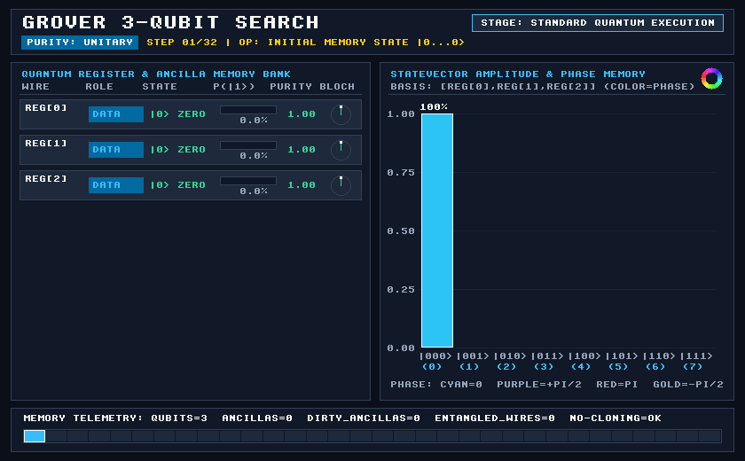
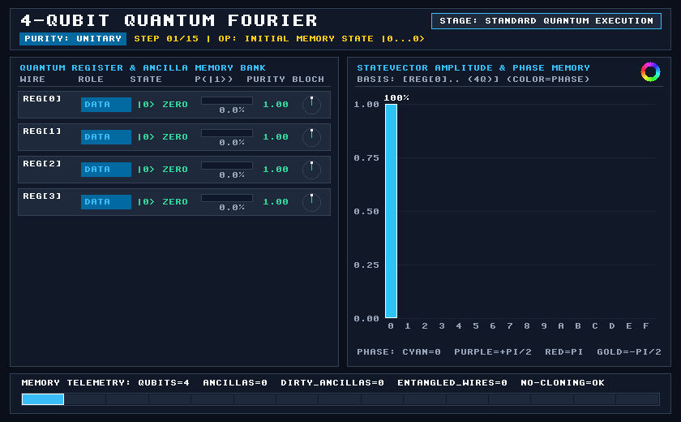
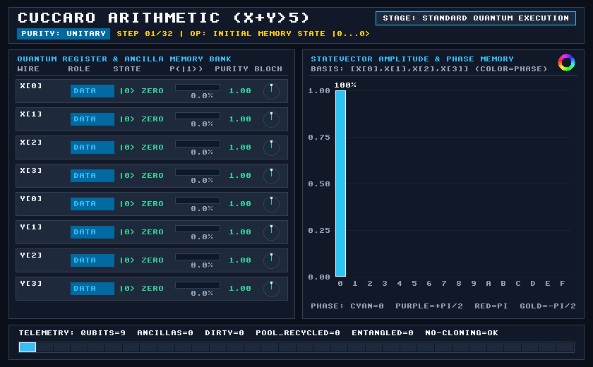
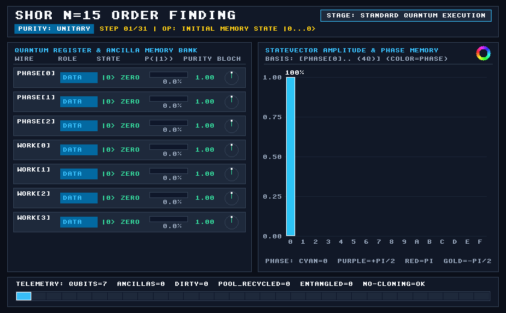
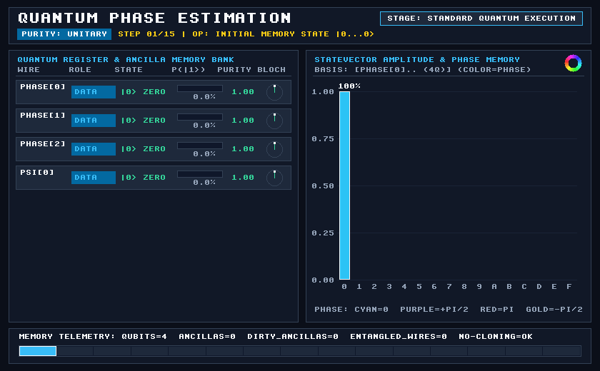
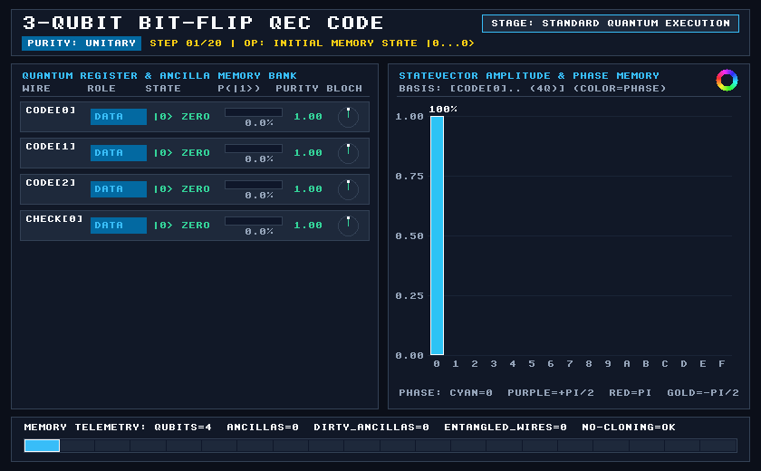
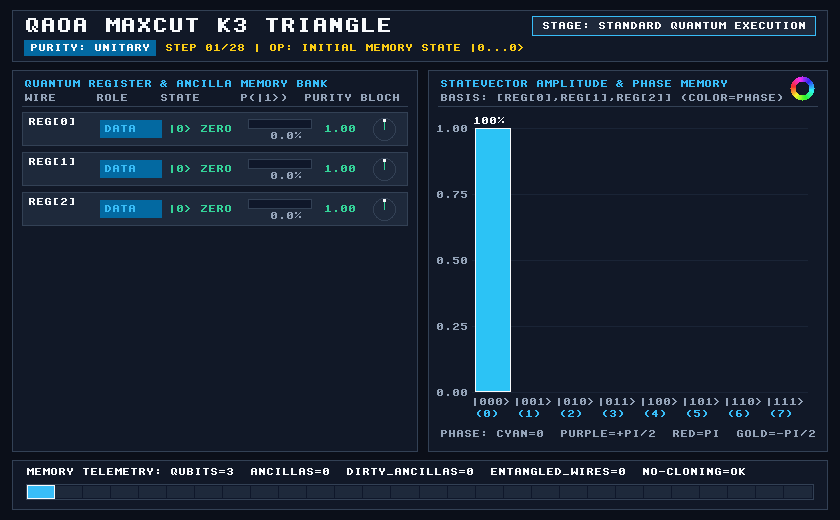
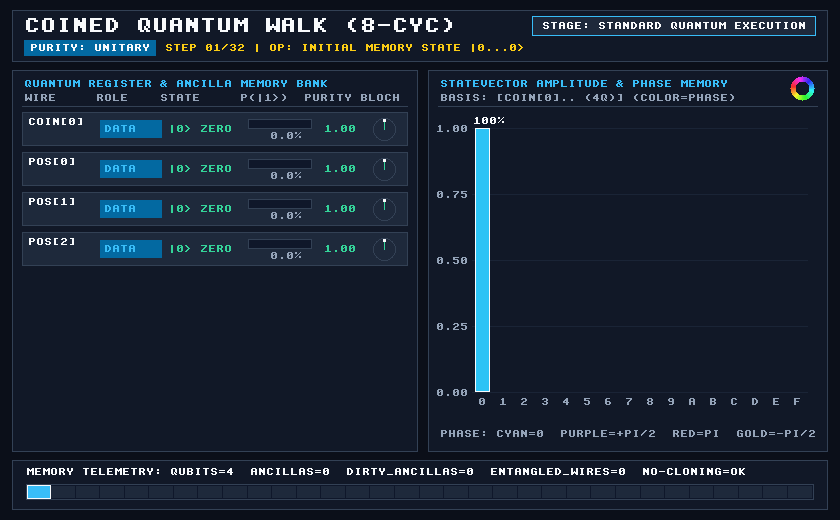
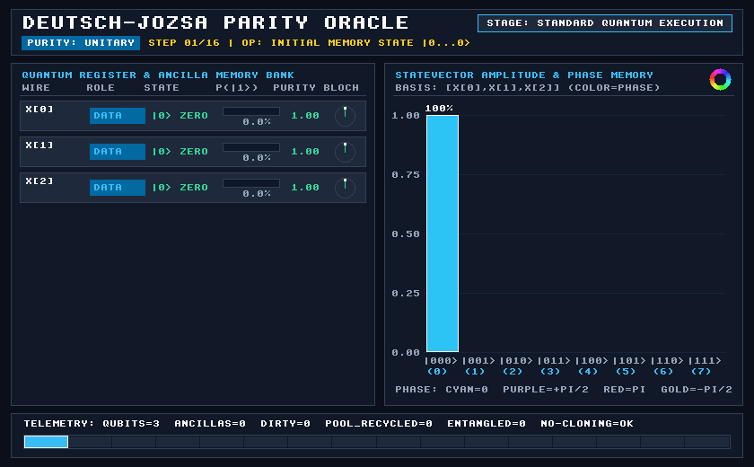
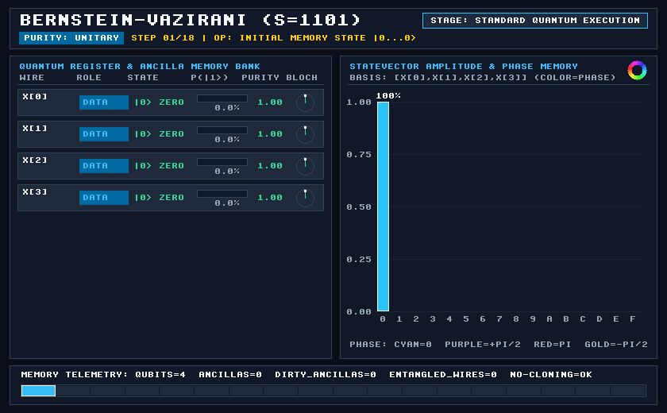

# QGo (`.qg`) Quantum Programming Language Documentation

Welcome to the official documentation for **QGo** (`.qg`), a statically-typed, Go-inspired quantum programming language and multi-target Ahead-Of-Time (AOT) compiler written in Rust.

QGo combines the clean ergonomics of Go (`package`, `import`, `func`, `:=`, `defer`, slice broadcasting `reg[:]`) with strict compile-time quantum physics enforcement:
- **Linear Quantum Types (`qubit`, `qreg[N]`, `qint[N]`, `qfixed[N, M]`)**: Enforces the No-Cloning Theorem (`E0400`) and prevents quantum register aliasing (`E0401`) at compile time.
- **Three-Tier Purity Hierarchy (`qfree`, `unitary`, and Hybrid)**: Statically separates classical-reversible logic (`qfree`), coherent isometric evolutions (`unitary`), and mid-circuit measurement feedback (Hybrid).
- **Zero-Leak Automatic Uncomputation (`defer adj`)**: Automatically schedules the exact Hermitian adjoint ($U^\dagger$) of ancilla computations via Bennett's $U V U^\dagger$ conjugation and applies the **Control-Skip Optimization Theorem** ($\Lambda_c(U V U^\dagger) \equiv U \cdot \Lambda_c(V) \cdot U^\dagger$) to save up to 66% in Toffoli / $T$-gate overhead.
- **Multi-Target AOT & Self-Hosting Compiler**: Lowers `.qg` programs to **OpenQASM 3.0**, **LLVM QIR 1.0**, **Quantinuum HUGR v1 JSON**, and **Standalone Native Executables** (with a verified 3-stage self-hosting bootstrap fixed point in [`selfhost/qgo_compiler.qg`](../selfhost/qgo_compiler.qg)).

---

## Documentation Suite

| Document | Description |
| :--- | :--- |
| [**Language Specification (`LANGUAGE_SPEC.md`)**](./LANGUAGE_SPEC.md) | Complete lexical rules, Automatic Semicolon Insertion (ASI), linear quantum types, purity modifiers (`qfree`, `unitary`), `defer adj`, `ctrl`/`adj` modifiers, quantum conditionals, built-ins, and formal EBNF grammar. |
| [**Quantum Memory Model (`QUANTUM_MEMORY_MODEL.md`)**](./QUANTUM_MEMORY_MODEL.md) | Deep dive into QGo's linear quantum memory lifecycle, reduced density matrix purity $\text{Tr}(\rho_q^2)$, Bloch vector telemetry, `E0400`–`E0403` compile-time diagnostics, and animated GIF memory traces. |
| [**Quantum Algorithms Guide (`ALGORITHMS_GUIDE.md`)**](./ALGORITHMS_GUIDE.md) | Mathematical foundations, QGo source walkthroughs, resource estimates, and animated quantum memory GIFs for all 12 standard library quantum algorithms in [`std/`](../std/). |
| [**Compiler Architecture (`COMPILER_ARCHITECTURE.md`)**](./COMPILER_ARCHITECTURE.md) | Internals of the 11-crate Rust workspace, HIR/MIR lowering, optimization passes, OpenQASM 3.0 / QIR / HUGR / Rust AOT backends, simulators (`StatevectorSim`, `StabilizerSim`, `QGoVM`), and 3-stage self-hosting bootstrap verification. |

---

## Quickstart & CLI Reference

### 1. Write a Quantum Program with Automatic Ancilla Uncomputation

```go
package grover

func AllOnesOracle(x qreg[3], flag qubit) qfree {
    ctrl(x[0], x[1], x[2]) X(flag)
}

func GroverStep3(reg qreg[3]) unitary {
    // 1. Allocate zeroed ancilla |0> and compute phase-kickback oracle
    flag := qalloc()
    AllOnesOracle(reg, flag)
    defer adj AllOnesOracle(reg, flag) -> flag
    Z(flag)
    // `defer adj` automatically uncomputes `flag` back to |0> and frees it here!

    // 2. Inversion about the mean
    H(reg[:])
    X(reg[:])
    ctrl(reg[0], reg[1]) Z(reg[2])
    X(reg[:])
    H(reg[:])
}
```

### 2. CLI Commands (`qgo`)

```bash
# Run quantum statevector, Clifford stabilizer, and QGoVM unit tests
cargo run -p qgo_driver -- test std/grover.qg

# Estimate logical qubits, ancilla qubits, Toffoli count, T-count, and circuit depth
cargo run -p qgo_driver -- estimate std/shor.qg --synth-mode=width

# Compile to OpenQASM 3.0, LLVM QIR 1.0, Quantinuum HUGR v1 JSON, or Native Binary
cargo run -p qgo_driver -- build std/grover.qg --target=qasm
cargo run -p qgo_driver -- build std/grover.qg --target=qir
cargo run -p qgo_driver -- build std/grover.qg --target=hugr
cargo run -p qgo_driver -- build selfhost/qgo_compiler.qg --target=native -o qgo_selfhost

# Generate an animated GIF89a quantum memory dashboard for any function
cargo run -p qgo_driver -- viz std/grover.qg GroverSearch3Qubit -o docs/gifs/grover_memory.gif

# Format QGo source code or emit LSP diagnostics
cargo run -p qgo_driver -- fmt std/grover.qg
cargo run -p qgo_driver -- lsp std/grover.qg
```

---

## Animated Quantum Memory Gallery

Every animated GIF below was generated directly by QGo's built-in quantum memory tracer (`qgo viz` / `qgo_sim::viz`), tracking per-qubit excitation $P(\vert 1\rangle)$, reduced density matrix purity $\text{Tr}(\rho_q^2) \in [0.5, 1.0]$, XZ Bloch vectors, `COMPUTE (U)` $\to$ `ACTION (V)` $\to$ `DEFER ADJ UNCOMPUTE (U†)` lifecycle transitions, and complex statevector amplitudes:

### 1. Grover's 3-Qubit Quantum Search ([`std/grover.qg`](../std/grover.qg))


### 2. 4-Qubit Quantum Fourier Transform ([`std/qft.qg`](../std/qft.qg))


### 3. Reversible Cuccaro Arithmetic & Quantum Conditional `if x + y > 5` ([`std/arith.qg`](../std/arith.qg))


### 4. Shor's Order-Finding Modular Exponentiation $7^x \bmod 15$ ([`std/shor.qg`](../std/shor.qg))


### 5. Quantum Phase Estimation on $T$-Gate ($\theta = 1/8$) ([`std/phase_est.qg`](../std/phase_est.qg))


### 6. 3-Qubit Bit-Flip Quantum Error Correction Syndrome & `defer adj` ([`std/qec.qg`](../std/qec.qg))


### 7. QAOA MaxCut on $K_3$ Triangle Graph ([`std/vqe_qaoa.qg`](../std/vqe_qaoa.qg))


### 8. Coined Quantum Walk on an 8-Cycle with Carry Uncomputation ([`std/quantum_walk.qg`](../std/quantum_walk.qg))


### 9. Deutsch-Jozsa Balanced Parity Oracle ([`std/deutsch_jozsa.qg`](../std/deutsch_jozsa.qg))


### 10. Bernstein-Vazirani Secret String $s = 1101_2$ Recovery ([`std/bernstein_vazirani.qg`](../std/bernstein_vazirani.qg))

