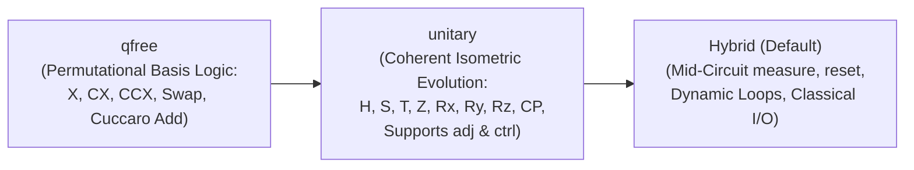

# QGo (`.qg`) Formal Language Specification

**QGo** (`.qg`) is a statically-typed, Go-inspired quantum programming language designed for fault-tolerant Ahead-Of-Time (AOT) compilation, automatic ancilla management, and hybrid quantum-classical execution.

---

## 1. Lexical Elements & Automatic Semicolon Insertion (ASI)

### 1.1 Source Encoding & Comments
QGo source files are UTF-8 encoded text files with the `.qg` extension. Both line comments (`// ...`) and block comments (`/* ... */`) are stripped during tokenization while preserving exact byte spans (`qgo_span::Span`).

### 1.2 Keywords
```text
package   import    func      struct    const     var
return    if        else      for       defer
unitary   qfree     adj       ctrl
qalloc    measure   reset
qubit     qreg      qint      qfixed
bool      int       int64     uint      float64   string
true      false
```

### 1.3 Go-Compliant Automatic Semicolon Insertion (ASI)
Implemented in [`crates/qgo_lexer/src/lib.rs`](../crates/qgo_lexer/src/lib.rs), QGo applies Go's exact lexical Automatic Semicolon Insertion rule:
When the input is broken into tokens, a synthetic `;` (`Token::Semi`) is automatically inserted into the token stream immediately after a line's final token if that token is:
1. An identifier (`Ident`) or built-in type keyword (`qubit`, `int`, `float64`, `bool`, `string`),
2. An integer, floating-point, boolean, or string literal (`IntLit`, `FloatLit`, `StringLit`, `true`, `false`),
3. One of the keywords `return`, `unitary`, or `qfree`,
4. One of the closing delimiters `)`, `]`, or `}`, or the postfix operators `++` / `--`.

---

## 2. Type System: Classical Value Types vs. Linear Quantum Types

QGo partitions its type universe into **Copyable Classical Value Types** and **Non-Copyable Linear Quantum Types** (implemented in [`crates/qgo_hir/src/lib.rs`](../crates/qgo_hir/src/lib.rs)).

### 2.1 Classical Value Types (`Copy`)
Classical types represent standard values stored in classical registers or host memory. They may be freely copied, reassigned, compared, and returned:
- **Primitives**: `bool`, `int`, `int64`, `uint`, `float64`, `string`
- **Composites**:
  - Fixed-size arrays: `[N]T`
  - Dynamic slices: `[]T`
  - Structures: `struct { field1 T1; field2 T2 }`

### 2.2 Linear Quantum Types (Move & Mutate-In-Place Only)
Quantum types represent physical or logical qubits governed by unitary quantum mechanics and the **No-Cloning Theorem**:

| Type | Width (Qubits) | Semantics |
| :--- | :---: | :--- |
| `qubit` | $1$ | Single logical quantum bit initialized in $\vert 0\rangle$. |
| `qreg[N]` | $N$ | Fixed-size quantum register of $N$ addressable qubits (`reg[0]` .. `reg[N-1]`). |
| `qint[N]` | $N$ | $N$-bit two's-complement quantum integer supporting reversible arithmetic (`+=`, `-=`, `+`, `-`, `==`, `<`, `>`). |
| `qfixed[N, M]` | $N$ | Quantum fixed-point number with $N$ total bits and $M$ fractional bits. |

#### Compile-Time Linearity Rules
1. **No-Cloning Enforcement (`E0400`)**: A quantum variable or register element cannot be copied or assigned by value (`q2 := q1` is rejected at compile time). Quantum values are created exclusively via `qalloc()` or passed as in-place references to quantum gates and functions.
2. **Disjoint Register Aliasing Check (`E0401`)**: Within any multi-operand quantum gate, `ctrl(...)` modifier, or function call, all quantum arguments must refer to Provably Disjoint Qubit Wires. Passing overlapping wires (e.g., `CX(q, q)`, `ctrl(reg[0]) X(reg[0])`, or `Swap(reg[0:2], reg[1:3])`) is rejected with diagnostic `E0401`.

---

## 3. Three-Tier Function Purity Hierarchy

Every function declaration in QGo belongs to one of three strict purity tiers, forming a lattice $\text{qfree} \subset \text{unitary} \subset \text{hybrid}$:



### 3.1 `func Name(...) qfree` (Classical-Reversible Tier)
- **Allowed Operations**: Basis-preserving classical-reversible permutations ($X$, $CX$, $CCX$, $\text{Swap}$, reversible arithmetic `+=`, `-=`, and calls to other `qfree` functions).
- **Forbidden Operations**: Superposition-creating or phase gates ($H, S, T, Z, R_x, R_y, R_z, CP$ — rejected with `E0200`) and mid-circuit measurements (`measure` — rejected with `E0201`).
- **Special Capabilities**:
  - Automatically invertible (`adj`) and controllable (`ctrl`).
  - May be used as the compute oracle in `defer adj CallExpr -> ancilla`.
  - May be used inside coherent quantum conditionals (`if x + y > 5 { ... }`).

### 3.2 `func Name(...) unitary` (Coherent Unitary Tier)
- **Allowed Operations**: All `qfree` operations plus arbitrary coherent unitary gates ($H, Y, Z, S, S^\dagger, T, T^\dagger, R_x(\theta), R_y(\theta), R_z(\theta), P(\theta), CP(\theta)$, Draper QFT arithmetic) and calls to `qfree` or `unitary` functions.
- **Forbidden Operations**: Non-unitary `measure(q)` (`E0201`), `reset(q)`, or classical I/O (`println`).
- **Special Capabilities**:
  - Automatically supports prefix structural adjoint `adj Func(...)` ($U^\dagger$) and controlled execution `ctrl(c1, ...) Func(...)` ($\Lambda_c(U)$).
  - Every local ancilla allocated inside a `unitary` function via `qalloc()` **must** be uncomputed via `defer adj` before scope exit; otherwise the compiler emits `E0402` (*Uncomputed Ancilla*).

### 3.3 `func Name(...)` (Default / Hybrid Tier)
- **Allowed Operations**: All `unitary` and `qfree` calls, mid-circuit projective measurements (`m := measure(q)`), qubit reset (`reset(q)`), measurement-conditioned `if` / `for` loops, classical arrays/slices/strings, I/O, and unit test assertions (`assert`, `assert_eq`, `prob_zero`, `prob_basis`, `peek_uint`).
- **Restrictions**: Cannot be inverted with `adj` (`E0300`) or controlled with `ctrl(...)` (`E0301`) because projective measurement is non-unitary.

---

## 4. Quantum Statements, Modifiers, and Built-Ins

### 4.1 Quantum Allocation (`qalloc`)
- `q := qalloc()` allocates 1 qubit initialized in $\vert 0\rangle$.
- `reg := qalloc[N]()` allocates an $N$-qubit register initialized in $\vert 0\dots 0\rangle$.

### 4.2 Automatic Uncomputation (`defer adj`)
```go
flag := qalloc()
Oracle(x, flag)
defer adj Oracle(x, flag) -> flag
Z(flag)
```
The `defer adj CallExpr -> target` statement pairs the preceding forward `CallExpr` ($U$) with its structural inverse ($U^\dagger$) at the end of `target`'s active scope, lowering into a first-class `MirStmt::Conjugate { compute, action, target }` block ($U V U^\dagger$).
- **Mutation Guard (`E0403`)**: While a `defer adj` is active, any statement in the action block $V$ that mutates or measures an input register of $U$ (except the ancilla `target` itself in phase-kickback or controlled reads) is checked to prevent corrupting the uncomputation.

### 4.3 Prefix Modifiers (`adj` and `ctrl`)
Both statements and call expressions in `qfree` and `unitary` contexts can be prefixed with `adj` and `ctrl(...)`:
- **`adj Stmt`**: Reverses the topological statement order of `Stmt` and replaces each gate with its Hermitian conjugate ($S \leftrightarrow S^\dagger$, $T \leftrightarrow T^\dagger$, $R_z(\theta) \leftrightarrow R_z(-\theta)$, $\text{Add} \leftrightarrow \text{Sub}$).
- **`ctrl(c1, c2, ...) Stmt`**: Conditions `Stmt` on the control qubits/slices `c1, c2, ...`. Modifiers compose arbitrarily (e.g., `ctrl(c) adj QFT3(reg)`).

### 4.4 Slice Broadcasting (`reg[a:b]` and `reg[:]`)
Single-qubit gates and 2-qubit gates automatically broadcast across register slices:
- `H(reg[:])` expands to `H(reg[0]); H(reg[1]); ...; H(reg[N-1])`.
- `X(reg[1:3])` expands to `X(reg[1]); X(reg[2])`.

### 4.5 Coherent Quantum Conditionals & In-Place Arithmetic
Inside `unitary` and `qfree` functions, `if` statements whose condition is a relational expression over `qint[N]` or `qreg[N]` registers are lowered into reversible compute-action-uncompute comparator circuits:
```go
func ConditionalFlipIfSumGt5(x qint[4], y qint[4], target qubit) unitary {
    if x + y > 5 {
        X(target)
    }
}
```
The compiler automatically:
1. Synthesizes an in-place Cuccaro ripple-carry addition `x += y`,
2. Allocates a zeroed comparator ancilla `cmp_anc` and evaluates `[x > 5] -> cmp_anc`,
3. Executes the body controlled on `cmp_anc` (`ctrl(cmp_anc) X(target)`),
4. Uncomputes `[x > 5]` and restores `x -= y` via `adj`, leaving zero residual ancilla entanglement.

### 4.6 Built-In Quantum Gates & Verification Intrinsics

| Category | Built-In Signatures | Purity Tier |
| :--- | :--- | :--- |
| **Pauli & Permutation Gates** | `X(q)`, `NOT(q)`, `CX(c, t)`, `CNOT(c, t)`, `CCX(c0, c1, t)`, `Toffoli(c0, c1, t)`, `Swap(a, b)` | `qfree` |
| **Clifford & Phase Gates** | `H(q)`, `Y(q)`, `Z(q)`, `S(q)`, `Sdg(q)`, `T(q)`, `Tdg(q)` | `unitary` |
| **Parameterized Rotations** | `Rx(theta, q)`, `Ry(theta, q)`, `Rz(theta, q)`, `P(theta, q)`, `Phase(theta, q)`, `CP(theta, c, t)`, `CRz(theta, c, t)` | `unitary` |
| **Reversible Arithmetic** | `CuccaroAdd(a, b)`, `CuccaroSub(a, b)`, `DraperAdd(a, b)`, `DraperSub(a, b)`, `a += b`, `a -= b` | `qfree` / `unitary` |
| **Measurement & Reset** | `measure(q) -> int`, `reset(q)` | Hybrid |
| **Simulator Verification** | `prob_zero(q) -> float64`, `prob_basis(reg, k) -> float64`, `peek_uint(reg) -> int`, `assert(cond)`, `assert_eq(a, b)` | Hybrid / Test |

---

## 5. Formal EBNF Grammar

```ebnf
SourceFile      = PackageClause ";" { ImportDecl ";" } { TopLevelDecl ";" } .
PackageClause   = "package" Identifier .
ImportDecl      = "import" ( StringLit | "(" { StringLit ";" } ")" ) .
TopLevelDecl    = FuncDecl | StructDecl | ConstDecl .

ConstDecl       = "const" Identifier [ Type ] "=" Expr .
StructDecl      = "struct" Identifier "{" { Identifier Type ";" } "}" .
FuncDecl        = "func" Identifier "(" [ ParamList ] ")" [ PurityMod ] [ [ "->" ] Type ] Block .
ParamList       = Param { "," Param } .
Param           = Identifier Type .
PurityMod       = "unitary" | "qfree" .

Type            = ClassicalType | QuantumType | SliceType | ArrayType | IdentType .
ClassicalType   = "bool" | "int" | "int64" | "uint" | "float64" | "string" .
QuantumType     = "qubit"
                | "qreg" "[" ConstExpr "]"
                | "qint" "[" ConstExpr "]"
                | "qfixed" "[" ConstExpr "," ConstExpr "]" .
SliceType       = "[" "]" Type .
ArrayType       = "[" ConstExpr "]" Type .

Block           = "{" { Stmt ";" } "}" .
Stmt            = DeclStmt
                | AssignStmt
                | DeferAdjStmt
                | QuantumModStmt
                | IfStmt
                | ForStmt
                | ReturnStmt
                | Block
                | ExprStmt .

DeclStmt        = Identifier ":=" Expr
                | "var" Identifier Type [ "=" Expr ] .
AssignStmt      = Expr ( "=" | "+=" | "-=" | "^=" ) Expr
                | Expr ( "++" | "--" ) .
DeferAdjStmt    = "defer" "adj" CallExpr [ "->" Identifier ] .
QuantumModStmt  = ( "adj" | "ctrl" "(" ExprList ")" ) Stmt .
IfStmt          = "if" Expr Block [ "else" ( IfStmt | Block ) ] .
ForStmt         = "for" [ SimpleStmt ";" Expr ";" SimpleStmt | Expr ] Block .
ReturnStmt      = "return" [ Expr ] .
ExprStmt        = Expr .

Expr            = BinaryExpr | UnaryExpr | QuantumModExpr | PrimaryExpr .
QuantumModExpr  = ( "adj" | "ctrl" "(" ExprList ")" ) Expr .
PrimaryExpr     = Identifier
                | Literal
                | "qalloc" [ "[" ConstExpr "]" ] "(" ")"
                | "measure" "(" Expr ")"
                | PrimaryExpr "(" [ ExprList ] ")"
                | PrimaryExpr "[" [ Expr ] [ ":" [ Expr ] ] "]"
                | PrimaryExpr "." Identifier
                | "(" Expr ")" .
```
