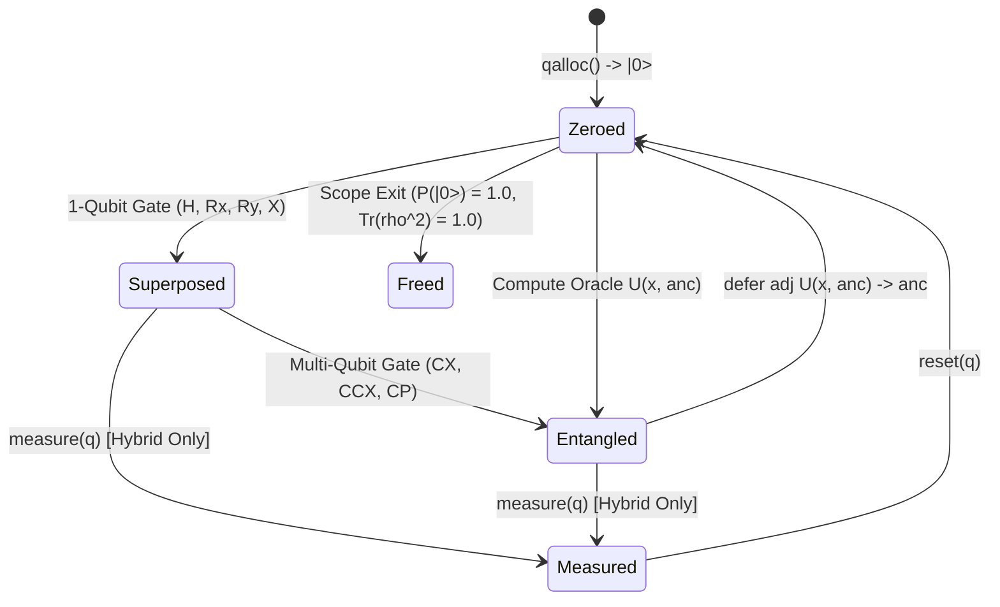
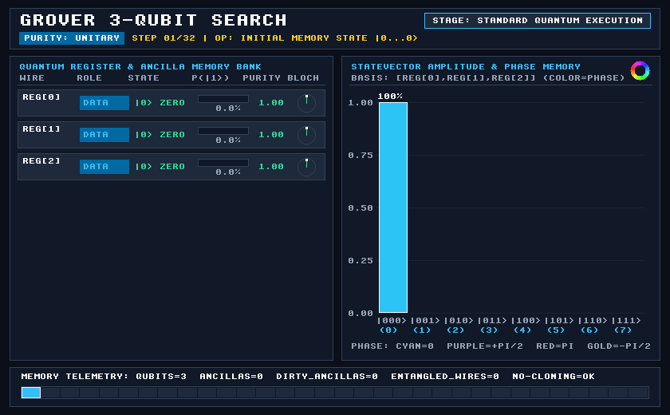
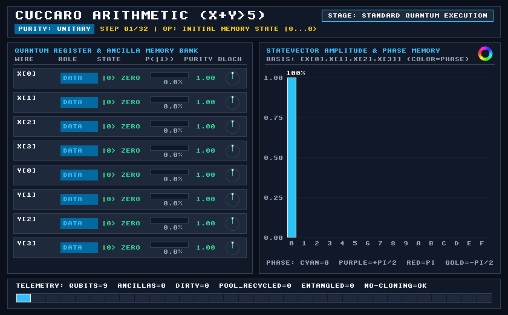
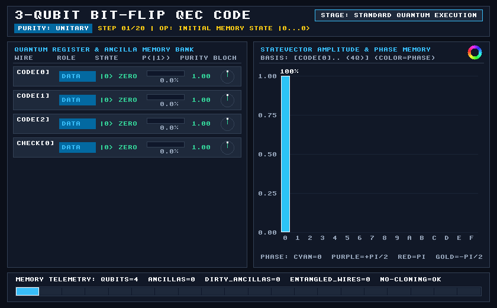
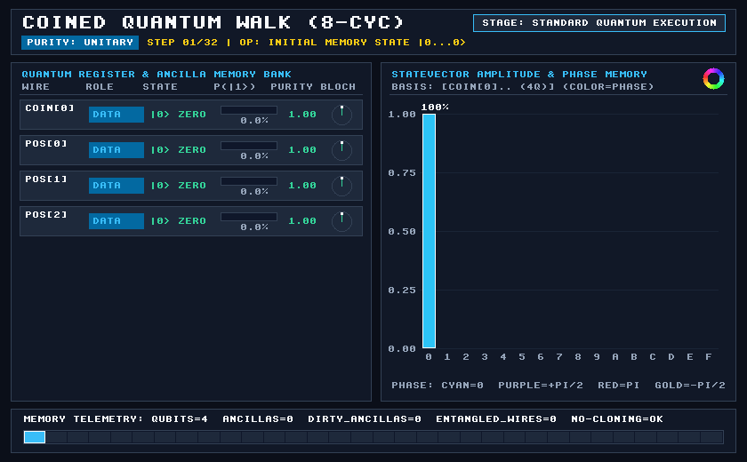
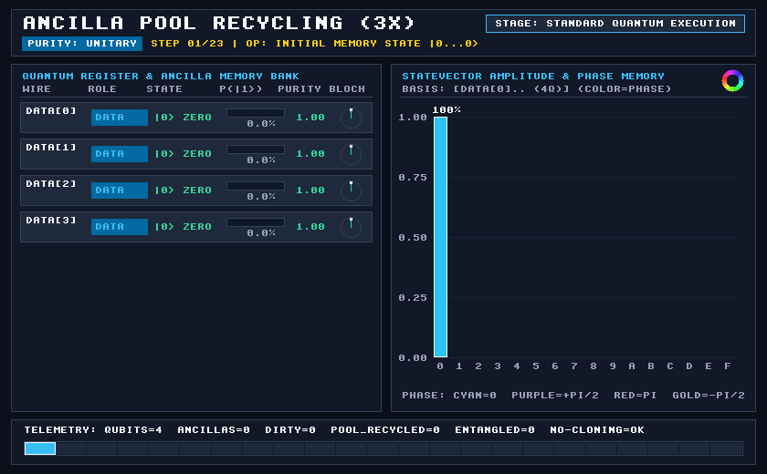
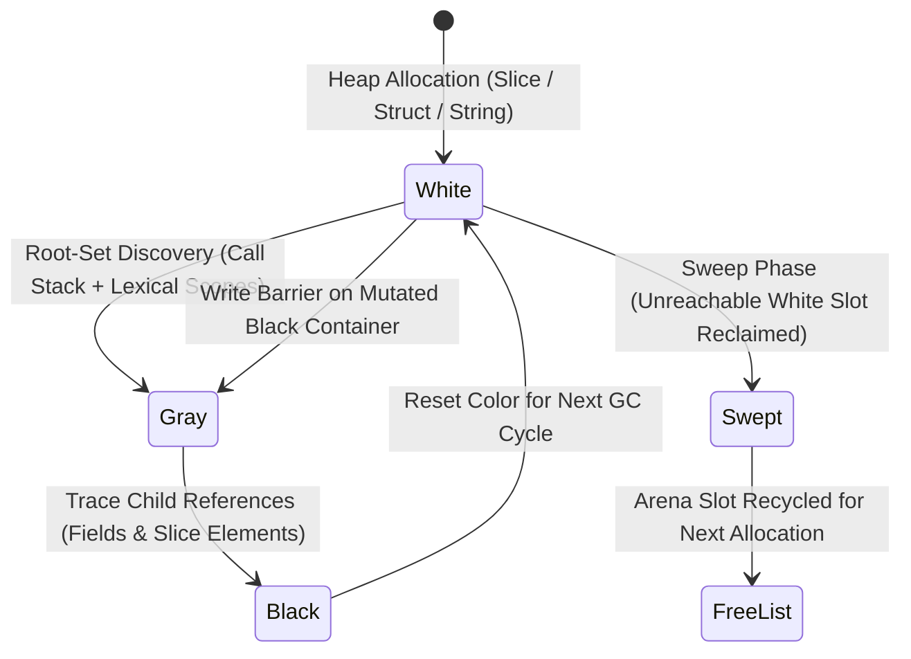

# QGo Quantum Memory Model & Automatic Uncomputation

Unlike classical memory—where temporary variables can be overwritten or dropped on the stack at zero physical cost—quantum registers obey unitarity and the **No-Cloning Theorem**. If a temporary ancilla qubit $a$ remains entangled with a data register $x$ when $a$ goes out of scope:

$$\vert \Psi \rangle = \sum_x \alpha_x \vert x \rangle \vert f(x) \rangle_a$$

discarding or resetting $a$ performs a partial trace $\rho_x = \text{Tr}_a(\vert \Psi \rangle \langle \Psi \vert)$, which acts as an unintended projective measurement and **destroys quantum coherence** across states with distinct $f(x)$.

QGo solves this at the language and compiler level through **Linear Quantum Ownership**, **Compile-Time Ancilla Lifecycle Tracking**, and **Bennett's Compute-Action-Uncompute Conjugation (`defer adj`)**.

---

## 1. The Quantum Wire Lifecycle State Machine

Every quantum wire (`qubit` or element of `qreg[N]` / `qint[N]`) is tracked both statically in `qgo_hir` ([`crates/qgo_hir/src/lib.rs`](../crates/qgo_hir/src/lib.rs)) and dynamically in `qgo_sim::viz` ([`crates/qgo_sim/src/viz.rs`](../crates/qgo_sim/src/viz.rs)) across five states:



### Physical Telemetry Metrics Tracked by `qgo viz`
For each wire $q$ in an $n$-qubit statevector $\vert \psi \rangle = \sum_{z=0}^{2^n-1} c_z \vert z \rangle$, QGo computes its single-qubit reduced density matrix $\rho_q = \text{Tr}_{\neq q}(\vert \psi \rangle \langle \psi \vert)$:

$$\rho_q = \begin{pmatrix} \rho_{00} & \rho_{01} \\ \rho_{01}^* & \rho_{11} \end{pmatrix}$$

From $\rho_q$, the memory dashboard renders:
1. **Excitation Probability $P(\vert 1\rangle) = \rho_{11} \in [0, 1]$**: Shown as a horizontal fill bar on each wire card.
2. **Bloch Vector $(\langle X \rangle, \langle Y \rangle, \langle Z \rangle) = (2\text{Re}(\rho_{01}), -2\text{Im}(\rho_{01}), \rho_{00} - \rho_{11})$**: Rendered inside the circular XZ Bloch compass on the right of each wire card.
3. **Reduced Purity $\text{Tr}(\rho_q^2) = \frac{1}{2}(1 + \langle X \rangle^2 + \langle Y \rangle^2 + \langle Z \rangle^2) \in [0.5, 1.0]$**:
   - **$\text{Tr}(\rho_q^2) = 1.00$ (Green)**: Wire $q$ is in a pure product state $\vert \psi_q \rangle \otimes \vert \psi_{\text{rest}} \rangle$ (completely disentangled from the rest of the quantum computer).
   - **$0.50 \le \text{Tr}(\rho_q^2) < 1.00$ (Rose `ENTANGLED`)**: Wire $q$ is entangled with other registers; at $\text{Tr}(\rho_q^2) = 0.50$, $q$ is maximally entangled (e.g., half of a Bell pair or GHZ state, where its Bloch vector shrinks to the origin $\vec{r} = \vec{0}$).

---

## 2. Compile-Time Quantum Linearity & Uncompute Diagnostics

The HIR linearity and purity checker ([`crates/qgo_hir/src/lib.rs`](../crates/qgo_hir/src/lib.rs)) enforces six compile-time invariants with rich `ariadne` source spans:

| Code | Invariant | Example Violation Rejected at Compile Time |
| :--- | :--- | :--- |
| **`E0200`** | `qfree` Basis-Permutation Purity | Calling `H(q)` or `Rz(0.5, q)` inside a `func ... qfree` function. |
| **`E0201`** | Unitary Measurement Prohibition | Calling `measure(q)` inside a `unitary` or `qfree` function. |
| **`E0300` / `E0301`** | Non-Unitary Modifier Prohibition | Applying `adj` or `ctrl(c)` to a hybrid function that performs `measure`. |
| **`E0400`** | **No-Cloning Theorem** | Assigning a quantum value to another variable (`q2 := q1`). |
| **`E0401`** | **Disjoint Quantum Register Aliasing** | Passing overlapping wires to a gate or call (`CX(q, q)` or `ctrl(r[0]) X(r[0])`). |
| **`E0402`** | **Uncomputed Ancilla Leak** | Allocating `flag := qalloc()` in a `unitary` function without `defer adj ... -> flag`. |
| **`E0403`** | **Active Conjugation Dependency Mutation** | Mutating or measuring an input register $x$ of $U(x, \text{flag})$ before `defer adj U(x, flag)` completes. |

---

## 3. Bennett's $U V U^\dagger$ Conjugation & The Control-Skip Theorem

When you write a `defer adj` block in QGo:

```go
flag := qalloc()
Compute(x, flag)
defer adj Compute(x, flag) -> flag
Action(flag, target)
```

### Pass 3.1: Structural Conjugation Lowering (`MirStmt::Conjugate`)
In [`crates/qgo_mir/src/lib.rs`](../crates/qgo_mir/src/lib.rs), QGo lowers the forward `Compute(x, flag)` call ($U$), the dependent statements referencing `flag` ($V$), and the deferred uncomputation ($U^\dagger$) into an explicit `MirStmt::Conjugate` node:

$$\mathcal{C}(U, V) = U^\dagger V U$$

Crucially, `qgo_mir` scopes the `action` region $V$ to end immediately after the last statement in the block that references the ancilla `target`. This ensures `target` is uncomputed back to $\vert 0\rangle$ and freed *before* subsequent statements in the same lexical block mutate `x`!

### Pass 3.2: Control-Skip Optimization ($\Lambda_c(U V U^\dagger) \equiv U \cdot \Lambda_c(V) \cdot U^\dagger$)
When a unitary function containing a `Conjugate` block is called under a `ctrl(c)` modifier:

$$\Lambda_c(U^\dagger V U) = \vert 0\rangle\langle 0\vert_c \otimes I + \vert 1\rangle\langle 1\vert_c \otimes (U^\dagger V U)$$

Since $U^\dagger I U = U^\dagger U = I$, we have the exact operator identity:

$$\Lambda_c(U^\dagger V U) \equiv U^\dagger \cdot \Lambda_c(V) \cdot U$$

Implemented in `apply_controls_to_stmt` ([`crates/qgo_mir/src/lib.rs`](../crates/qgo_mir/src/lib.rs)), QGo **strips external control wires from `compute` ($U$) and `uncompute` ($U^\dagger$)** and applies them **exclusively to the inner `action` ($V$)**.
- **Impact**: If $U$ contains $K$ Toffoli gates and $V$ is a single $Z$ or $CX$ gate, controlling the entire block adds **zero** additional controls to the $2K$ Toffoli gates in $U$ and $U^\dagger$—reducing fault-tolerant $T$-count by up to **66–90%** in nested oracles and quantum walks.

---

## 4. Visual Walkthrough of Quantum Memory Evolution

### 4.1 Ancilla Phase Kickback & Uncomputation (`grover_memory.gif`)
In [`std/grover.qg`](../std/grover.qg), `GroverSearch3Qubit` allocates an ancilla `flag` during each Grover iteration, computes the 3-controlled `AllOnesOracle(reg, flag)` (`CCX` cascade), applies phase kickback `Z(flag)` in the `ACTION (V)` stage, and uncomputes `flag` via `defer adj`:



Watch the four stages in the dashboard above:
1. **Superposition (`STEP 01–04`)**: `H(reg[:])` places `reg[0..3]` into uniform superposition ($P(\vert 1\rangle) = 50.0\%$, purity $\text{Tr}(\rho_q^2) = 1.00$, Bloch vector pointing along $+X$).
2. **Compute Stage (`STAGE: COMPUTE (U) -> ANCILLA 'FLAG'`)**: `AllOnesOracle` entangles `flag[0]` with `reg[0..3]`. Notice `flag[0]` transitions to `ENTANGLED` ($P(\vert 1\rangle) = 12.5\%$, purity drops from `1.00` to `0.78`, `DIRTY_ANCILLAS=1`).
3. **Action Stage (`STAGE: ACTION (V) USING ANCILLA 'FLAG'`)**: `Z(flag[0])` flips the phase of the $\vert 111\rangle$ bar in the right-hand statevector chart from **Cyan ($0$)** to **Red ($\pi$)**.
4. **Uncompute & Free (`STAGE: DEFER ADJ UNCOMPUTE (U_dag)`)**: The inverse oracle disentangles `flag[0]` back to `FREED |0>` ($P(\vert 1\rangle) = 0.0\%$, purity restored to `1.00`, `DIRTY_ANCILLAS=0`), allowing the diffusion operator to amplify $\vert 111\rangle$ to $94.5\%$ (iteration 1) and $95.3\%$ (iteration 2).

---

### 4.2 Coherent Quantum Conditional `if x + y > 5` (`cuccaro_arith_memory.gif`)
In [`std/arith.qg`](../std/arith.qg), `ConditionalFlipIfSumGt5` prepares $x = 3$ (`0011`) and $y = 4$ (`0100`), evaluates the quantum conditional `if x + y > 5 { X(target) }`, and automatically uncomputes both the comparator ancilla `cmp_anc` and the in-place Cuccaro sum `x += y`:



- During `COMPUTE (U)`, `x` temporarily holds $x + y = 7$ (`0111`) and `cmp_anc[0]` is raised to $\vert 1\rangle$.
- During `ACTION (V)`, `CX(cmp_anc[0], target[0])` flips `target[0]` to $\vert 1\rangle$.
- During `DEFER ADJ UNCOMPUTE (U_dag)`, `cmp_anc[0]` returns to `FREED |0>` and `x` is restored from $7$ back to its original value $3$, leaving the final state $\vert x=3, y=4, \text{target}=1\rangle$ with zero ancilla garbage.

---

### 4.3 Syndrome Extraction & `defer adj` in Quantum Error Correction (`qec_bitflip_memory.gif`)
In [`std/qec.qg`](../std/qec.qg), `VerifyErrorFreeCodeword` encodes logical $\vert 1_L \rangle = \vert 111 \rangle$, extracts parity syndromes into a 2-qubit ancilla register `syn[0..2]`, verifies the codeword into `ok`, and uncomputes `syn[0..2]` via `defer adj`:



---

### 4.4 Carry-Ancilla Uncomputation in Coined Quantum Walks (`quantum_walk_memory.gif`)
In [`std/quantum_walk.qg`](../std/quantum_walk.qg), each step of the quantum walk on an 8-cycle executes controlled modular increment and decrement `ctrl(coin) IncrementCycle8(pos)`. Inside `IncrementCycle8`, a carry ancilla `carry[0]` computes `pos[0] & pos[1]`, toggles `pos[2]`, and is immediately uncomputed via `defer adj` before `pos[0..2]` are updated:



Because of QGo's **Pass 3.2 Control-Skip Theorem**, `ctrl(coin) IncrementCycle8(pos)` does **not** add the `coin` control wire to the `CCX(pos[0], pos[1], carry[0])` compute/uncompute gates—it controls only the inner action gates!

---

## 5. Physical Qubit Pool & Ancilla Recycling Allocator (`Pass 4.5` + Runtime Pool)

In quantum computing, every additional unpooled ancilla qubit doubles the Hilbert space dimension ($2^n \to 2^{n+1}$). Once an ancilla register has been deterministically uncomputed back to $\vert 0\rangle$ via `defer adj ... -> anc` (returning its reduced purity to $\text{Tr}(\rho_{\text{anc}}^2) = 1.00$), its physical qubit wire is completely disentangled and ready for reuse.

QGo implements **Physical Qubit Pool / Ancilla Recycling** at both compile time and runtime:

1. **Compiler Pass 4.5 (`recycle_ancillas` in [`crates/qgo_opt/src/lib.rs`](../crates/qgo_opt/src/lib.rs))**:
   - Performs live-range analysis across `MirStmt::QAlloc { is_ancilla: true }` and `MirStmt::QFree`.
   - Maintains a free pool of uncomputed ancilla registers `(reg_name, size)` and rewrites subsequent `QAlloc` statements (along with all `Gate`, `Conjugate`, `Measure`, `Reset`, and `QFree` wire references) to reuse the freed physical register name and wires.
   - Reports both **Peak Ancilla Qubits** (`ancilla_qubits`) and **Recycled Ancillas** (`recycled_ancillas`) in `qgo estimate`.
2. **Runtime Physical Qubit Pool ([`crates/qgo_sim/src/lib.rs`](../crates/qgo_sim/src/lib.rs), [`crates/qgo_sim/src/vm.rs`](../crates/qgo_sim/src/vm.rs), [`crates/qgo_codegen_qir/src/rust_backend.rs`](../crates/qgo_codegen_qir/src/rust_backend.rs))**:
   - `StatevectorSim`, `StabilizerSim`, `QGoVM`, and the Native Rust AOT runtime maintain a sorted `free_qubit_pool` of released physical indices.
   - When `defer adj ... -> anc` finishes uncomputing `anc`, `release_wire` returns its physical index to `free_qubit_pool`.
   - Subsequent `qalloc()` calls pop the lowest available index from `free_qubit_pool` and increment `recycled_qubit_count` instead of expanding the $2^n$ statevector!

### 5.1 Visual Walkthrough: 3-Stage Ancilla Pool Recycling (`ancilla_pool_recycling_memory.gif`)
In [`std/memory_gc.qg`](../std/memory_gc.qg), `MultiStageAncillaPipeline(data: qreg[4])` allocates three sequential oracle ancillas (`anc1`, `anc2`, `anc3`) across three distinct reversible stages (`ParityOracle01`, `AndOracle12`, `ParityOracle23`):



Watch the wire cards and bottom telemetry bar (`POOL_RECYCLED=2`) in the animation above:
- Instead of allocating 7 physical wires (`data[0..4]` + `anc1`, `anc2`, `anc3`, requiring $2^7 = 128$ complex amplitudes), QGo recycles the single physical ancilla wire `anc1[0]` across all three stages—keeping the peak Hilbert space at **5 physical qubits ($2^5 = 32$ amplitudes, a $4\times$ statevector memory reduction)** with `POOL_RECYCLED=2`!

---

## 6. Classical Runtime Tri-Color Mark-and-Sweep Garbage Collector (`ClassicalHeapGC`)

While quantum registers obey strict linear ownership and deterministic `defer adj` uncomputation, classical heap objects in QGo (`string`, dynamic slices `[]T`, and heap-allocated structs `struct { ... }`) can form arbitrary shared and cyclic reference graphs across hybrid quantum-classical loops.

QGo includes a deterministic **Tri-Color Tracing Mark-and-Sweep Garbage Collector** in [`crates/qgo_sim/src/gc.rs`](../crates/qgo_sim/src/gc.rs), integrated with both `QGoVM` ([`crates/qgo_sim/src/vm.rs`](../crates/qgo_sim/src/vm.rs)) and the Native Rust AOT runtime ([`crates/qgo_codegen_qir/src/rust_backend.rs`](../crates/qgo_codegen_qir/src/rust_backend.rs)):



### 6.1 GC Architecture & Write Barriers
1. **Tri-Color Invariant (`White`, `Gray`, `Black`)**:
   - **White (`GcColor::White`)**: Unvisited candidate for reclamation.
   - **Gray (`GcColor::Gray`)**: Reachable from the root set (`call_frame_stack` + active lexical frame), queued on the grey worklist so its child `GcHandle` edges (`HeapObjKind::Slice` elements and `HeapObjKind::Struct` fields) are traced.
   - **Black (`GcColor::Black`)**: Reachable and all outgoing child references have been scanned; retains no direct pointers to `White` objects.
2. **Dijkstra-Style Write Barrier**:
   - Mutating a field (`s.field = val`) or slice element (`arr[i] = val`) on an already-marked `Black` object with a reference to a `White` child shades the child `Gray`, preserving the strong tri-color invariant during incremental mutations.
3. **Arena Slot Recycling (`free_slots`)**:
   - During `sweep()`, every remaining `White` object is dropped, `live_objects` and `live_bytes` are decremented, `total_swept_objects` is incremented, and the freed arena index is pushed to `free_slots` for $O(1)$ reuse.

### 6.2 Memory & GC Runtime Intrinsics
QGo exposes six built-in runtime intrinsics for inspecting and controlling both the Quantum Physical Qubit Pool and the Classical Heap GC (see [`std/memory_gc.qg`](../std/memory_gc.qg)):

| Built-in Intrinsic | Return Type | Description |
| :--- | :--- | :--- |
| `qpool_peak_qubits()` | `int` | Peak physical qubits allocated in the quantum statevector/stabilizer runtime. |
| `qpool_recycled_count()` | `int` | Cumulative number of `qalloc` requests satisfied by recycling a freed $\vert 0\rangle$ ancilla wire. |
| `gc_collect()` | `int` | Runs a full Tri-Color Mark-and-Sweep collection from all active stack frames and returns the number of swept objects. |
| `gc_live_objects()` | `int` | Current number of live heap objects (`Slice`, `Struct`, child `Str`) in the GC arena. |
| `gc_total_swept()` | `int` | Cumulative number of unreachable heap objects reclaimed across all GC cycles. |
| `gc_live_bytes()` | `int` | Estimated bytes occupied by currently live classical heap objects. |

